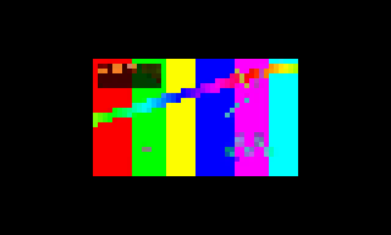

# TermiPlayer (`player`)

**A media player that lives inside your terminal.** Video *and* audio, offline, keyboard-first,
one small binary.

```bash
player movie.mkv            # just play the thing
player testsrc              # prove the render path, no media needed
player probe                # what did we detect about this terminal, and why
player doctor               # something looks wrong: ask me
```

> **Status: M0–M2 complete and verified.** Video and audio play. Seven graphics
> backends work. A/V sync uses an audio master clock. The adaptive throughput
> controller makes real decisions. 145 unit + 25 integration checks pass,
> including under ASan/UBSan.
>
> **Not yet built:** the library, queue and resume (M3/M6) — the part that makes
> it a *player* rather than a renderer. See [`docs/ROADMAP.md`](docs/ROADMAP.md).
>
> Built in C, not the planned Rust: no Rust toolchain and no crates.io access in
> the build environment. The reasoning, and what it cost, is in
> [`docs/BUILD-LOG.md`](docs/BUILD-LOG.md) §1.



*Actual output, not a mockup: `testsrc2` 320x180 @ 24 fps decoded through FFmpeg
and rendered as truecolor half-blocks, captured from the binary's escape stream
and rasterised by `tools/render_frames.py`.*

---

## Install and run

```bash
make                 # needs only a C compiler and make
./player movie.mkv
```

Requires `ffmpeg` on `PATH` (or `TERMIPLAYER_FFMPEG=/path/to/ffmpeg`) for video
and for audio *decoding*. Audio *output* needs nothing: it uses libpulse via
`dlopen` when present and plays silently when not.

```bash
make test            # 145 unit + 25 integration checks
make test-san        # the same, under ASan + UBSan
sh tools/mkfixtures.sh   # generate the test media (needs ffmpeg)
```

---

## The one-sentence pitch

> Everyone else built a *renderer*. We are building the first **player**.

That distinction is the entire project. `mpv --vo=tct`, `ncplayer`, `timg`, `chafa` and the
recent wave of Rust terminal players all answer "how do I get pixels into a terminal?".
None of them answer "I have 400 files, what do I watch next, and put me back where I stopped."

---

## What it looks like (M3 target — the TUI is not built yet)

```
┌ TermiPlayer ────────────────────────────── ── ♪ 03:12 / 1:47:38 ── Volume 72% ─┐
│ LIBRARY › Films › Sci-Fi (18)                     │  BLADE RUNNER 2049           │
│                                                    │  Denis Villeneuve · 2017      │
│  ▸ Arrival                          2016   ✓ 87%  │  2h 43m · 4K HDR · HEVC      │
│  ▸ Blade Runner 2049                2017   ✓ 100% │                              │
│  ▸ Dune                             2021   ✓ 41%  │  ┌──────────────────────────┐│
│  ▸ Dune: Part Two                   2024       —  │  │                          ││
│  ▸ Ex Machina                       2014   ✓ 100% │  │      video renders        ││
│  ▸ Interstellar                     2014   ✓ 12%  │  │      here at the          ││
│                                                    │  │      terminal's real      ││
│  QUEUE                                             │  │      pixel resolution     ││
│  1. Dune: Part Two          ← next                 │  │                          ││
│  2. Annihilation                                   │  └──────────────────────────┘│
│  3. Sicario                                        │                              │
├────────────────────────────────────────────────────┴──────────────────────────────┤
│ ▁▂▃▅▇█▇▅▃▂▁  space pause · ←→ seek · j/k vol · s subs · f fullscreen · q quit     │
└───────────────────────────────────────────────────────────────────────────────────┘
```

*This is a design mockup of the M3 interface, not a screenshot. The playback
engine underneath it exists; the library views do not yet. What does exist right
now renders at whatever your terminal can do — real pixels
(kitty/WezTerm/Ghostty/iTerm2), sixel, or truecolor blocks — auto-detected, over
ssh, inside tmux.*

---

## Why it will stand out

| | Today | TermiPlayer |
|---|---|---|
| **Scope** | renderer, or library, never both | renderer **now**, library/queue/resume next |
| **Audio** | `ncplayer`, `timg`, `chafa` have none | audio is first-class, audio-only path works |
| **Slow links** | fixed quality, stutters | **adaptive throughput controller** — measures the pty and renegotiates resolution live |
| **Diagnosis** | "it doesn't work" | `player probe` / `player doctor` explain every choice |
| **Fidelity** | folklore-driven (delta-encoding SGR) | **measured** — our spike shows that trick saves 0.0%, so we don't do it |

Full analysis, with star counts and source-verified claims:
**[`docs/COMPETITORS.md`](docs/COMPETITORS.md)**.

## Evidence, not vibes

The plan rests on a spike in [`spikes/`](spikes/) that measured bytes-per-frame and
encode cost for six backends across three content types and three terminal sizes.

The headline result contradicts what the whole niche repeats:

```
            24-bit   delta%   sixel      kitty   kitty+z
80x24        71,301      0.1   4,228     15,504     7,852   bytes/frame
320x90    1,067,412      0.0  15,145    232,566    52,114   bytes/frame
```

Delta-encoding SGR pair by pair — the trick `rtv` claims buys "30-50% fewer bytes" —
saves **0.0%** on real footage, because every cell in truecolor video is already a
unique colour. What actually matters is a hard ceiling no one talks about:

> **At 320x90, 24-bit half-blocks max out at 9 fps on a 10 MB/s pty.**
> The design must negotiate resolution against frame rate, not pretend it can have both.

That constraint is what the adaptive throughput controller exists to solve, and it is
the mechanism nobody else in this space has.

Numbers, method and the full results table: [`spikes/RESULTS.md`](spikes/RESULTS.md).

---

## What works today

**Playback**
- Video: anything your `ffmpeg` decodes (H.264, HEVC, AV1, VP9, ...), scaled at
  the source by swscale
- Audio: anything ffmpeg decodes, resampled to 48 kHz stereo, out through
  libpulse (PipeWire included) via `dlopen`, an fd, or silently
- Audio master clock with smoothing and ffplay-compatible drop/repeat thresholds
- Seeking (`left`/`right` 5 s, `pgup`/`pgdn` 60 s, `home`, `-t TIME`)
- Pause, speed 1/4x-4x, duration limit, stats overlay
- Audio-only mode does no raster work at all

**Terminal output** — auto-detected, seven rungs, each with a recorded reason
- kitty graphics: shared memory when local (a flat ~64 B/frame), direct+zlib remote
- iTerm2 inline images (OSC 1337)
- sixel: content-aware palette depth, ordered Bayer dither, RLE, banded
- truecolor half-blocks with SGR-on-change and run-length
- 256-colour half-blocks, ASCII, and a `TERM=dumb` safe path
- **Adaptive throughput controller**: measures real bytes/second to the pty and
  trades resolution for frame rate; caps fps instead of resolution when CPU-bound
- synchronized output (DEC 2026) around every frame, so no tearing

**Diagnostics**
- `player probe` — every capability, and why each backend was taken or skipped
- `player doctor` — the five things that actually break, checked and explained

## Not built yet

Straight answer, because the README should not oversell:

- **The library, queue and resume** — the whole point of "a player, not a
  renderer". M3/M6, not started.
- Subtitles, chapters (M4).
- Gapless playback; speed control does not yet pitch-preserve audio.
- Hardware decode (ffmpeg does it, we do not expose a flag yet).
- Everything in `docs/ROADMAP.md` §1 is implemented but **unverified**, because
  the build environment has no tty and no sound device.

## Plan

| | Milestone | State |
|---|---|---|
| **M0** | Skeleton & probe | **done** — `testsrc`, ladder, `probe`, `doctor`, pty throughput harness |
| **M1** | Video core | **done** — decode, scale, kitty/blocks/ascii, seek, resize, pacing |
| **M2** | Audio & sync | **done** — audio master clock, drop/repeat, seek re-sync, audio-only |
| **M5** | Every terminal | **partially done** — sixel, iTerm2 and the controller exist; real-terminal verification pending |
| **M3** | The TUI | not started — the differentiator |
| **M4** | Text on screen | HUD only |
| **M6** | Memory (library) | not started — the moat |
| **M7** | Ship | `make install` exists; packaging pending |

Milestone scope, acceptance criteria and the risk register:
**[`docs/ARCHITECTURE.md`](docs/ARCHITECTURE.md)**.
What was actually built, which bugs testing caught, and what changed from the
plan: **[`docs/BUILD-LOG.md`](docs/BUILD-LOG.md)**.

---

## Tech stack

C11, no build dependencies beyond a compiler and libc. Optional libraries (zlib
for kitty compression, libpulse for audio) are resolved at runtime with `dlopen`
and degrade gracefully. Decoding drives an `ffmpeg` subprocess behind a
`DecodeSource` interface, so swapping in linked libavcodec later touches one file.

The original plan specified Rust (`ratatui`, `ffmpeg-the-third`, `symphonia`,
`cpal`); `docs/BUILD-LOG.md` §1 explains why that was not possible here, and
`docs/ROADMAP.md` §2 is the port plan.

---

## License

MIT — see [LICENSE](LICENSE).
